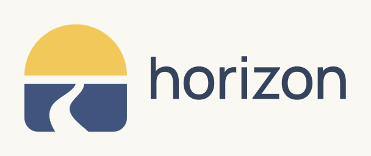

<!-- horizon: the README of the template -->

<div align="center">
<br/>
<picture>
  <source media="(prefers-color-scheme: dark)" srcset="docs/assets/v1/brand/motion/horizon-logo-dark.gif">
  <source media="(prefers-color-scheme: light)" srcset="docs/assets/v1/brand/motion/horizon-logo-light.gif">
  
</picture>

**Track your job search in a private Github repository.**

[](https://github.com/can-sevinc/horizon) [](https://github.com/can-sevinc/horizon/stargazers) [](LICENSE)

Each application is an issue and a card on a project board. Github Actions keep everything up to date. No server, no subscription.

[Get started](#setup) · [Features](#features) · [Documentation](https://can-sevinc.github.io/horizon/)

</div>

## Features

<!-- GIF: the bookmark on a job post -->
- <picture><source media="(prefers-color-scheme: dark)" srcset="docs/assets/v1/icons/icon-save-dark.svg"></picture> **Save jobs in one click.** A bookmark picks up the company, position, link, and description from Linkedin, Greenhouse, Lever, Ashby, Workday, Teamtailor, and [other sites](docs/supported-sites.md).

<!-- GIF: a card moving on the board -->
- <picture><source media="(prefers-color-scheme: dark)" srcset="docs/assets/v1/icons/icon-board-dark.svg"></picture> **The board updates itself.** New issues become cards, and closing an issue sets the right status.

<!-- GIF: /interview and /next in an issue -->
- <picture><source media="(prefers-color-scheme: dark)" srcset="docs/assets/v1/icons/icon-commands-dark.svg"></picture> **Comment commands.** `/interview`, `/next 2026-12-01 call`, `/offer`, `/rejected` and a few more. They also work in the Github mobile app.

<!-- GIF: a weekly summary -->
- <picture><source media="(prefers-color-scheme: dark)" srcset="docs/assets/v1/icons/icon-reminders-dark.svg"></picture> **Reminders and weekly summaries.** Get follow-up reminders, see the companies that went quiet, and get your weekly stats every Monday.

- <picture><source media="(prefers-color-scheme: dark)" srcset="docs/assets/v1/icons/icon-transfer-dark.svg"></picture> **Import and export.** Bring your old spreadsheet, and export everything as JSON or CSV any time.

- <picture><source media="(prefers-color-scheme: dark)" srcset="docs/assets/v1/icons/icon-skills-dark.svg"></picture> **AI agent skills.** Interview prep, CV tailoring, follow-up emails, offer comparisons and [more skills](docs/skills.md).

<p align="center">
  <picture>
    <source media="(prefers-color-scheme: dark)" srcset="docs/assets/v1/brand/horizon-divider-dark.svg">
    
  </picture>
</p>

## Setup

**In your browser:** Click [Use this template](https://github.com/can-sevinc/horizon/generate), select **Private**, and follow the **Finish the setup** issue in your new repository.

**In your terminal:** Requires `gh` and `git`.

```bash
gh repo create job-applications --private --template can-sevinc/horizon --clone
cd job-applications
bash scripts/setup.sh
```

See the [setup guide](docs/setup.md).

When the Horizon template changes, the **Update** workflow opens a pull request in your copy. [How updates work](docs/updates.md).


## Privacy

Your applications, notes, and salary details stay in your private repository. Setup refuses to run in a public repository, and a daily check warns you if its visibility changes.

When setup creates your board, it sends one event to the optional [usage counter](https://horizon.mcansevinc.workers.dev/badge). The event doesn't include your repository name, username, or application data. Set `telemetry: false` in [`config.yaml`](config.yaml) to turn it off.

## Configuration

Set your time zone, reminder times, statuses, fields, and labels in [`config.yaml`](config.yaml). Run setup again to apply changes.

## Development

```bash
node --test "tests/*.test.js"
```

See [`AGENTS.md`](AGENTS.md) for coding agent instructions.

## License

[MIT](LICENSE)
