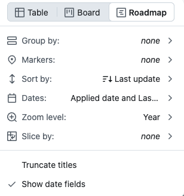

# Setup

You need a Github account. For the setup on your computer you also need `gh` (the Github CLI) and `git`. Python 3 is only needed to import old data.

## In the browser

1. Click **Use this template** > **Create a new repository** and choose **Private**. Your applications will be issues in this repository, so it has to stay private.
2. After a minute, an issue called **Finish the setup** opens in your copy. It has three steps: make a token, save it as the secret `PROJECT_TOKEN`, and run **Actions** > **Setup**. The Setup fields show the default settings (Stockholm, for example), so change the ones that don't fit you. If the issue doesn't show up, run **Actions** > **Welcome** by hand.
3. When the setup is done, it closes that issue and opens two new ones with the `setup` label: **Prepare the board** and **Add the bookmark**. Follow them and close them when you are done.

## On your computer

```bash
gh auth login
gh repo clone can-sevinc/horizon job-applications
cd job-applications
bash scripts/setup.sh
```

The script:

- creates a private repository for you if the folder isn't yours yet, and keeps the template as the remote `upstream`
- stops if your repository is public
- asks for your settings (board name, city, time zone, reminder times, and so on). Press Enter to keep the value in brackets. The answers go into `config.yaml`.
- opens a page to make the token and saves it as `PROJECT_TOKEN`
- runs the **Setup** workflow, which opens the same two issues as in the browser, and saves the bookmark to `data/bookmarklet.txt`

## What the setup creates

Four views on the project board (the empty **View 1** of a new project becomes **Board**):

| View | Layout | Shows |
| --- | --- | --- |
| Board | Board | All applications, with **Applied date** and **Last update** on the cards |
| Table | Table | All applications |
| Interviews | Roadmap | **In progress**, **On hold**, and **Rejected after interview** |
| Summaries | Table | The weekly summaries |

The **Status** options:

| Status | Color | Meaning |
| --- | --- | --- |
| Wishlist | Pink | Not applied yet |
| Applied | Blue | Applied, no answer yet |
| In progress | Green | The process is going on |
| On hold | Yellow | Paused, you will continue later |
| Rejected after interview | Red | Stopped after at least one interview |
| Rejected without interview | Gray | Stopped before any interview |
| Offer | Purple | You got an offer |

It also adds the fields **Applied date**, **Last update**, **Company**, **Position**, **City**, **Salary range**, **Recruiter**, **Job link**, and **Interviews**, plus the labels from `config.yaml`. On a new board, it removes the default project workflows and the labels that Github adds to every repository (`bug`, `question`, and so on). Your copy also gets its own short README with links to your board. Don't rename the statuses: the workflows look for these names.

## Manual steps

Github doesn't let workflows sort views or set timeline dates, so the **Prepare the board** issue asks you to do this once:

| View | Settings |
| --- | --- |
| Board | Sort by **Last update**, new to old. Field sum: **Count** and **Interviews**. |
| Table | Sort by **Applied date**, old to new |
| Interviews | Sort by **Last update**, new to old. Dates: **Applied date** to **Last update**. Zoom level: **Year**. |
| Summaries | Sort by **Created**, new to old |

 

The **Add the bookmark** issue has your bookmark code. In Chrome, right-click the bookmarks bar, choose **Add page...**, and paste the code as the URL:


## Run the setup again

You can run the setup as often as you like, for example after you change `config.yaml`. It doesn't touch your issues or cards. It only adds what is missing and updates colors, descriptions, the form, and the workflow times. Your sorting, columns, and own views stay as they are. It doesn't open the setup issues again. It asks before it replaces the token.

To see what it would change without changing anything:

```bash
DRY_RUN=1 bash scripts/setup.sh
```

## The Setup workflow

You can also run **Actions** > **Setup** on Github without anything on your computer. It needs the `PROJECT_TOKEN` secret.

- The fields show your current settings from `config.yaml`. Change a field to change that setting. The workflow saves it to `config.yaml`, the form, and the field defaults in one commit.
- Tick **Dry run** to only see what would change.
- The run summary shows what it did, the manual steps, and the bookmark.
