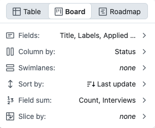
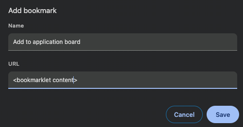

#  Setup
{: #setup }

You need a Github account. You can do the setup in your browser or on your computer. Choose the way you prefer.

## In the browser

1. Click **Use this template** > **Create a new repository**. Choose **Private**. Your applications will be issues in this copy.
2. Wait about a minute for the **Finish the setup** issue. Follow its steps to make a token, save it as `PROJECT_TOKEN`, and run **Actions** > **Setup**. Change the default city, time zone, and other fields if needed. If the issue does not appear, run **Actions** > **Welcome** yourself.
3. Setup closes that issue when it finishes. It opens **Prepare the board** and **Add the bookmark** with the `setup` label. Follow both, then close them.

After these steps, Horizon may ask for a star in an **Enjoying Horizon?** issue. It can ask once more on day 7. It does not ask if you already starred the project.

## On your computer

You need `gh` (the Github command-line tool) and `git`. Python 3 is only needed if you import old data.

```bash
gh auth login
gh repo clone can-sevinc/horizon job-applications
cd job-applications
bash scripts/setup.sh
```

The script makes a private repository if this folder is not your own copy yet. It keeps the original template as `upstream` and stops if your copy is public.

It asks for the board name, city, time zone, and reminder times. Press Enter to keep a value. It saves your answers in `config.yaml`, helps you make the token, and runs the **Setup** workflow. The bookmark code is also saved in `data/bookmarklet.txt`.

---

##  Your board
{: #your-board }

Setup creates four views. On a new project, the empty **View 1** becomes **Board**.

| View | Layout | What it shows |
| --- | --- | --- |
| Board | Board | All applications, with **Applied date** and **Last update** on the cards |
| Table | Table | All applications |
| Interviews | Roadmap | **In progress**, **On hold**, and **Rejected after interview** |
| Summaries | Table | Weekly summaries |

The default statuses are:

| Status | Meaning |
| --- | --- |
| Wishlist | You have not applied yet |
| Applied | You applied and are waiting for an answer |
| In progress | The process continues |
| On hold | Paused, but not finished |
| Rejected after interview | Stopped after at least one interview |
| Rejected without interview | Stopped before any interview |
| Offer | You got an offer |

Setup also adds the fields and labels from `config.yaml`. On a new board, it removes the default project workflows and the usual repository labels, such as `bug` and `question`.

Your copy gets a short README with links to your board. It does not keep this docs site or its images. It loads shared images from the `assetsUrl` address in `config.yaml`.

Do not rename a status only on the board. The names must match `config.yaml`.

## A few manual steps

Github does not let the workflow set view sorting or timeline dates. The **Prepare the board** issue gives you the links and these settings:

| View | Settings |
| --- | --- |
| Board | Sort by **Last update**, new to old. Field sum: **Count** and **Interviews**. |
| Table | Sort by **Applied date**, old to new |
| Interviews | Sort by **Last update**, new to old. Dates: **Applied date** to **Last update**. Zoom: **Year**. |
| Summaries | Sort by **Created**, new to old |




The **Add the bookmark** issue has your bookmark code. In Chrome, right-click the bookmarks bar, choose **Add page...**, and paste the code into the URL field.



---

##  Change settings later
{: #change-settings-later }

Run setup again after you change `config.yaml`. It adds missing fields and updates the labels, form, and workflow times. Your issues, cards, view sorting, and own views stay as they are. It does not open the setup issues again.

To check the changes first:

```bash
DRY_RUN=1 bash scripts/setup.sh
```

You can also use **Actions** > **Setup** in Github. Its fields show your saved settings. Change a field to save a new value, or tick **Dry run** to only see the planned changes. The run summary has the result and bookmark code.

## The install counter

**COUNT THIS COPY** is on by default. When Setup creates the board, it adds 1 to the [public board count](https://horizon.mcansevinc.workers.dev/badge). It sends only the event name, not your repository name, user, or applications.

Untick the checkbox, or set `telemetry: false` in `config.yaml`, to turn it off.
